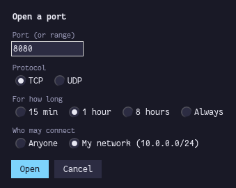
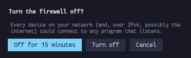
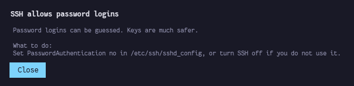
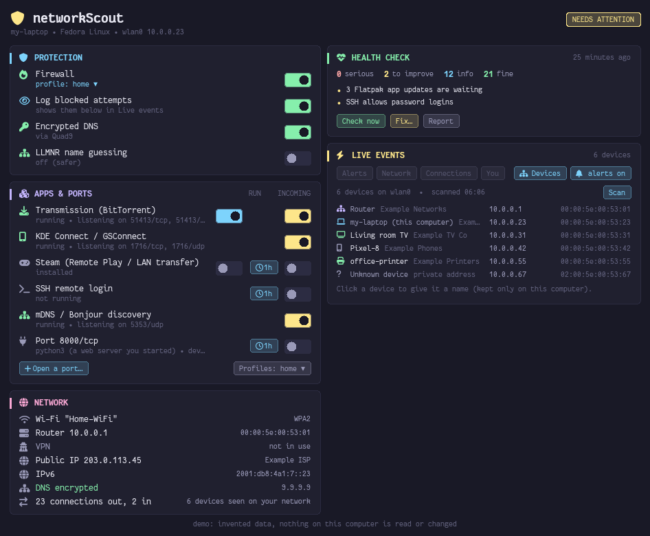
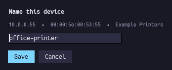

# networkScout

**A security and privacy check-up for any Linux computer, in plain language, with a desktop app that watches your network as things happen.**


-191926?style=flat-square&logo=linux&logoColor=white)
-86efac?style=flat-square)


<sub>All screenshots show the app's demo mode (`networkscout-app --demo`): an invented computer with addresses from the ranges reserved for documentation.</sub>

## Contents

1. [What networkScout is](#what-networkscout-is)
2. [Installation](#installation)
3. [What information it provides](#what-information-it-provides)
4. [Threats and attacks it detects and alerts on](#threats-and-attacks-it-detects-and-alerts-on)
5. [The desktop app](#the-desktop-app)
6. [Command-line usage](#command-line-usage)
7. [How it keeps you safe](#how-it-keeps-you-safe)
8. [Files and folders](#files-and-folders)
9. [Supported systems](#supported-systems)
10. [Tests](#tests)
11. [Troubleshooting](#troubleshooting)
12. [License](#license)

---

## What networkScout is

networkScout is two programs in one project:

- **`networkscout`**, a terminal command. It checks your computer and network in about 20 seconds, explains every result in plain language, and tells you what to do. It can also fix what it finds, control which ports and apps the network can reach, switch the firewall and its profiles, turn encrypted DNS on or off, and list the devices on your network.
- **`networkscout-app`**, a desktop app in the style of pySysMon. It shows your protection status with switches for the firewall, ports, apps and DNS, plus a **live event feed** of what happens on your network: new open ports, incoming connections, blocked attempts, wrong passwords, router impersonation, new root certificates and more. Serious events become desktop notifications. A **Devices** tab lists every device on your network with its name, maker, IP and MAC address.

It answers four questions:

| Question | In short |
|---|---|
| **1. Is my system secure?** | Updates (including a stalled automatic updater), firewall, disk encryption, Secure Boot, SELinux/AppArmor, kernel hardening, accounts, SSH, signs of tampering |
| **2. Is there a DNS leak?** | Who answers your DNS lookups, whether they are encrypted, leaks around a VPN, DNS hijacking and interception, forged-answer (DNSSEC) protection |
| **3. Is anyone in the middle?** | Router impersonation (ARP spoofing), rogue IPv6 routers, proxies, extra root certificates, HTTPS certificate checks, plain-HTTP tampering, Wi-Fi security, clock |
| **4. Is my network exposure safe?** | Every open port and the program behind it, firewall coverage, public IPv6 exposure, UPnP port forwarding on your router, what internet scanners see |

Design goals:

- **Plain language:** every finding has a short title, an explanation and "What to do".
- **Safe by default:** the check is read-only. Every change asks first, can be previewed (`--dry-run`) and comes with an undo script.
- **Runs anywhere:** one Python file, standard library only (Python 3.6+). It has its own DNS client and falls back to `/proc` and log files when tools like `ss`, `ip` or `journalctl` are missing.

---

## Installation

### Requirements

| Requirement | Notes |
|---|---|
| Linux with Python 3.6 or newer | Preinstalled on practically every distribution. Nothing else is required for the terminal command. |
| bash | Only for `install.sh`; preinstalled almost everywhere (Alpine: `apk add bash`). Without it, run `python3 networkscout.py` directly. |
| Administrator password | Only for changes (`fix`, `ports`, `firewall`, `dns`, the app's switches) and the deeper check with `sudo`. |
| firewalld or ufw | Needed for the port and firewall controls. The check itself works with any firewall. |
| systemd-resolved | Needed for the DNS switches. The DNS checks work everywhere. |
| Python with tkinter | For the app only. `install.sh` finds or sets one up. On Bazzite it reuses or creates a conda env with an Xft-enabled Tk for smooth fonts (`conky-env`, shared with pySysMon and pyQuotes). |
| [Fantasque Sans Mono Nerd Font](https://www.nerdfonts.com/font-downloads) | Optional: icons in the app. Without it the app uses plain text. |

### Install (recommended)

```bash
git clone https://github.com/y-v-j/networkScout.git && cd networkScout
./install.sh                         # commands, app and menu entry, all in your home folder (no root)
sudo ./install.sh --system-core      # recommended: root-owned copy for administrator actions (see "How it keeps you safe")
```

After that you have the `networkscout` command, the `networkscout-app` command, and **networkScout** in your applications menu.

### Installer options

| Option | What it does |
|---|---|
| `--startup none` | Default: the app does not start at login |
| `--startup widget` | Start the app at login on the desktop, below other windows (like pySysMon) |
| `--startup window` | Start the app at login as a normal window |
| `--python PATH` | Use this Python (with tkinter) for the app instead of auto-detecting one |
| `--no-start` | Do not open the app after installing |
| `--uninstall` | Remove networkScout (keeps your event log, reports and undo backups) |
| `--system-core` (with sudo) | Install a root-owned copy of the core in `/usr/local/lib/networkscout`; every administrator action then runs that copy |
| `--remove-system-core` (with sudo) | Remove that copy |
| `NETWORKSCOUT_CONDA_ENV=name` | Use a different conda env for the app (default `conky-env`) |

The installed launchers keep working after system updates: if the Python chosen at install time disappears, they fall back to any suitable Python. If none has tkinter, the app tells you to run `install.sh` again.

### Other ways to run it

```bash
python3 networkscout.py              # run the check without installing anything
python3 networkscout_gui.py          # run the app (needs a Python with tkinter)
pipx install .                       # install as a package: networkscout and networkscout-app commands
```

### Uninstall

```bash
./install.sh --uninstall
sudo ./install.sh --remove-system-core      # if you installed it
```

Settings you changed with networkScout stay as they are. To revert them, run the undo scripts (see [Files and folders](#files-and-folders)).

---

## What information it provides

### 1. System security

| Item | What you learn |
|---|---|
| Operating-system updates | Pending updates, including security updates, and whether a restart is needed. On rpm-ostree systems (Fedora Atomic, Bazzite, Bluefin, Aurora) it compares your image with the newest published one. It also supports dnf/yum, apt, pacman, zypper/transactional-update, apk, xbps, Gentoo (tree sync age) and NixOS. |
| App updates | Pending Flatpak and Snap updates |
| Automatic updater health | Whether the updater keeps skipping runs (e.g. Universal Blue's `uupd` treating the network as "busy" because a torrent client is running) |
| Secure Boot, kernel lockdown | On/off |
| SELinux / AppArmor | Enforcing, permissive or absent |
| Disk and swap encryption | Whether your files (`/home`, `/var/home`) and swap are on LUKS/dm-crypt, ecryptfs or gocryptfs; it warns more strongly on laptops |
| CPU vulnerabilities | Processor flaws (Spectre, Meltdown, ...) that are not mitigated |
| Kernel hardening | ASLR, symlink/hardlink protection, ptrace scope, kernel pointer and log restrictions, BPF, ICMP redirects, source routing, TCP timestamps, with a ready-made fix file |
| Accounts | Who can log in, who is an administrator, extra UID-0 accounts, accounts without a password (password check with `sudo`) |
| SSH server | Running or not, root login, password login, authorized keys |
| Signs of tampering | `/etc/ld.so.preload`, `LD_PRELOAD`, setuid programs in temporary folders, programs running from `/tmp` or `/dev/shm`, programs running from deleted files, kernel taint flags (unsigned or force-loaded modules), failed services |
| Things that start automatically | Your autostart entries, user services and cron jobs, listed so you can spot strangers |

### 2. DNS and DNS leaks

| Item | What you learn |
|---|---|
| Your DNS servers | Which servers your computer asks, and who they belong to (your router, ISP, Google, Cloudflare, Quad9, ...) |
| Encryption | Whether DNS uses DNS-over-TLS or a local encrypted-DNS program (dnscrypt-proxy, stubby, cloudflared, ...) |
| Who answers on the internet side | The resolver your lookups really leave through, and whether it is your internet provider |
| VPN DNS leaks | Whether lookups bypass your VPN tunnel |
| Hijacking | Whether non-existent names are redirected (ads or search pages from your provider) |
| Tampering | Whether well-known names resolve to their real addresses |
| Interception | Whether DNS sent to 1.1.1.1 / 8.8.8.8 is answered by someone else on the way, and whether a DNS provider is blocked on your network |
| Forged answers | Whether each DNS server rejects bad DNSSEC signatures |
| `/etc/hosts` | Redirected well-known sites, ad-block lists, custom entries |

### 3. Man-in-the-middle

| Item | What you learn |
|---|---|
| Router identity | Router IP and hardware (MAC) address, duplicates (ARP spoofing), changes since the last check, number of IPv6 routers |
| Wi-Fi | Network name and security type (open, WEP, WPA1, WPA2/3) |
| Proxies | Proxies set in the environment, `/etc/environment`, KDE or GNOME settings (including automatic WPAD), dnf/yum/apt |
| Extra root certificates | Certificates added to the system trust store: who made them, when, and whether the maker is known for inspecting HTTPS traffic |
| HTTPS certificates | Certificates of 10 well-known sites: issuer, Certificate Transparency proof, whether a local root certificate signed them |
| Plain-HTTP tampering | Captive portals, injected or changed web pages, transparent proxies |
| Clock | Whether your clock is right (wrong clocks break certificate checks) |

### 4. Network exposure

| Item | What you learn |
|---|---|
| Open ports | Every port other devices can connect to: the program behind it, what it is, and whether the firewall lets it in. Ports that only accept connections from this computer are listed separately as safe |
| Firewall | Which firewall runs (firewalld, ufw, nftables, iptables), its profile/zone, what it allows, wide-open port ranges |
| Public IPv6 | Whether your computer has public IPv6 addresses (no NAT), which open ports could be reached that way, and whether IPv6 privacy addresses are on |
| Name announcements | mDNS/Bonjour, LLMNR, NetBIOS, KDE Connect |
| Containers | Docker/Podman ports published to the network, a Docker socket anyone can use, membership in the `docker` group |
| Router port forwarding | Whether UPnP / NAT-PMP is on and which port forwardings point at this computer |
| What the internet sees | Open ports and known vulnerabilities on your public IPv4/IPv6 address, from Shodan's InternetDB |

### Outputs

| Output | How |
|---|---|
| Terminal | Coloured results with ✔ / i / ! / ✖ marks, details and "What to do", then a summary with the most important fixes first |
| Markdown report | `--report FILE.md`, or `--save` for `~/networkscout-reports/report-<time>.md` |
| JSON | `--json FILE` (or `-` for standard output) for scripts and dashboards |
| Exit code | `0` all fine, `1` things to improve, `2` serious problems |
| Live event log | The app writes every event to `~/.local/state/networkscout/events.log` (JSON lines) |
| Change tracking | A small baseline (router identity, open ports, root certificates) so the next run can say what is new |

---

## Threats and attacks it detects and alerts on

**Where it is reported:** ✓ **Check** means the full check (`networkscout` or the app's *Check now*). ⚡ **Live** means the app's event feed, within seconds. 🔔 **Alert** means a desktop notification.

### Man-in-the-middle and interception

| Threat | How networkScout detects it | Check | Live | Alert |
|---|---|:-:|:-:|:-:|
| **ARP spoofing** (a device pretending to be your router) | Your router's hardware address is also claimed by another IP address | ✓ | ⚡ | 🔔 |
| **Router replaced or impersonated** | The router's hardware address differs from the last check | ✓ | ⚡ | 🔔 |
| **Rogue IPv6 router** (router-advertisement attack) | More than one IPv6 router on the same network | ✓ | | |
| **HTTPS interception** (SSL inspection, malicious proxy) | Certificates of well-known sites are signed by a root certificate added to your computer, have no Certificate Transparency proof, or are rejected | ✓ | | |
| **Rogue root certificate installed** | A new or unknown certificate in the system trust store; makers of HTTPS-inspection products are flagged | ✓ | ⚡ | 🔔 |
| **Captive portal, injected ads, HTTP tampering** | Known test pages come back redirected or changed; proxy headers | ✓ | | |
| **Hidden proxy / WPAD hijacking** | Proxies in environment, system settings, package managers; automatic proxy detection | ✓ | | |
| **Hosts-file redirection** (phishing, malware) | Well-known sites (banks, Google, Microsoft, ...) redirected in `/etc/hosts` | ✓ | | |
| **Open or WEP Wi-Fi** | Security type of the connected network | ✓ | ⚡ | 🔔 |
| **Clock manipulation** | Your clock is compared with Cloudflare's | ✓ | | |

### DNS attacks and leaks

| Threat | How networkScout detects it | Check | Live | Alert |
|---|---|:-:|:-:|:-:|
| **DNS leak around a VPN** | DNS servers reached outside the tunnel; resolver owner differs from the VPN | ✓ | | |
| **DNS interception** (transparent DNS proxy) | Queries to 1.1.1.1 / 8.8.8.8 answered by someone other than Cloudflare / Google | ✓ | | |
| **DNS tampering / poisoning** | Names with fixed, known addresses resolve elsewhere | ✓ | | |
| **DNS hijacking** (NXDOMAIN redirection) | Non-existent names return an address | ✓ | | |
| **Forged answers accepted** | A deliberately broken DNSSEC domain resolves | ✓ | | |
| **Unencrypted DNS** (anyone on the path sees every site name) | No DNS-over-TLS or local encrypted-DNS program | ✓ | ⚡ | |
| **LLMNR poisoning** (attacker answers name lookups on public Wi-Fi) | LLMNR is on | ✓ | ⚡ | |
| **DNS settings changed** | DNS servers or encryption change | | ⚡ | |

### Exposure and intrusion attempts

| Threat | How networkScout detects it | Check | Live | Alert |
|---|---|:-:|:-:|:-:|
| **Dangerous services reachable** (databases, Redis, MongoDB, Docker API, VNC, Telnet, FTP, X11, Ollama, adb, ...) | Open ports checked against a list of risky services and against the firewall | ✓ | | |
| **New open port** | A program starts listening on the network | ✓ (vs. last check) | ⚡ | 🔔 if reachable |
| **Incoming connection from the internet** | Someone connects to an open port from outside your network | | ⚡ | 🔔 |
| **Port scans and blocked attempts** | Packets the firewall dropped (after switching on *Log blocked attempts*); replies to device discovery are labelled harmless | | ⚡ | |
| **SSH brute force, unknown SSH logins** | Failed passwords, invalid users, accepted logins (journal or auth.log) | | ⚡ | 🔔 |
| **Wrong administrator passwords** | Failed sudo and polkit authentications | | ⚡ | 🔔 |
| **Firewall turned off or opened up** | Firewall off, profile changed, services or ports added | ✓ | ⚡ | 🔔 if off |
| **Wide-open or "trusted" firewall** | Port ranges of 1000+ ports, zones that accept everything | ✓ | | |
| **Router opening ports for apps or malware** | UPnP port forwardings pointing at this computer | ✓ | | |
| **Exposed to internet scanners** | Shodan knows open ports or vulnerabilities on your public IP | ✓ | | |
| **Public IPv6 exposure** | Open ports reachable without NAT | ✓ | | |
| **Containers bypassing the firewall** | Docker/Podman-published ports; Docker socket writable by everyone | ✓ | | |
| **Connections to typical malware ports** | Outgoing connections to ports like 4444, 1337, 31337, 6667 | | ⚡ | 🔔 |
| **New devices on your network** | New addresses in the neighbour table | | ⚡ | |
| **VPN dropped** | VPN interface disappears | | ⚡ | |

### Signs of compromise and weak spots

| Threat | How networkScout detects it | Check |
|---|---|:-:|
| **Rootkit-style library injection** | `/etc/ld.so.preload` or `LD_PRELOAD` set | ✓ |
| **Privilege-escalation backdoors** | Setuid/setgid programs in `/tmp`, `/var/tmp`, `/dev/shm`; extra UID-0 accounts; accounts without a password | ✓ |
| **Malware running from temporary folders** | Processes whose program lives in `/tmp`, `/var/tmp` or `/dev/shm` | ✓ |
| **Malicious kernel modules** | Unsigned or force-loaded modules (kernel taint flags) | ✓ |
| **Persistence** | Autostart entries, user services, cron jobs listed for review | ✓ |
| **Remote-login risks** | SSH with root or password login | ✓ |
| **Missing security updates** | Pending OS/app updates, stalled updater, restart needed | ✓ |
| **Weak base protection** | No disk encryption, Secure Boot off, SELinux permissive, unmitigated CPU flaws, weaker kernel settings | ✓ |

### Alerts and notifications

- **Desktop notifications** are sent for serious events: firewall off, router impersonation, ARP spoofing, new root certificate, incoming connection from the internet, SSH failures or logins, wrong sudo passwords, joining an open Wi-Fi, a newly reachable port, and connections to typical malware ports. Turn them on or off with the bell in the app.
- **Every event** appears in the app's live feed, colour-coded (red serious, yellow warning, blue information, green good, lilac your own actions), and is saved to the event log.
- **The full check** gives each finding a level: ✖ serious, ! improve, i information, ✔ fine.

**Limits.** networkScout looks for well-known signs. It cannot prove that a computer is free of malware, and it does not inspect the contents of your traffic. Whether ports are reachable from the internet over IPv6 depends on your router's IPv6 firewall, which cannot be seen from inside your computer. Blocking *outgoing* connections per application needs an application firewall such as OpenSnitch; networkScout controls *incoming* connections.

---

## The desktop app

Start it from the applications menu or with `networkscout-app`.

| Card | What you see and can do |
|---|---|
| **Protection** | Firewall on/off and its profile (click to choose: public, home, work, strict, ...); log blocked attempts; encrypted DNS; LLMNR; warnings about wide-open port ranges (with **Close unused**) and extra root certificates (with **Fix…**) |
| **Apps & ports** | For each app (Transmission, qBittorrent, Deluge, KDE Connect, Syncthing, Steam, LocalSend, SSH, Samba, mDNS, printing): a **Run** switch (start/quit) and an **Incoming** switch (allow/block through the firewall), plus ⏱ **1h** to allow it for one hour. Every other open port gets the same controls. **Open a port…** lets you pick the protocol, the duration (15 min, 1 hour, 8 hours, always) and who may connect (anyone, or only your network) |
| **Network** | Cable or Wi-Fi (with security type), local IP, router and its hardware address, VPN, public IPv4 and its owner, IPv6, DNS in use, connections in and out, number of devices seen |
| **Health check** | The latest full check: counts and the top issues (click one for details and the fix). It runs automatically at most every 6 hours, and again after you change settings. **Fix…** opens `networkscout fix` in a terminal; **Report** opens the Markdown report |
| **Live events** | Newest first, scrollable, with filters **Alerts / Network / Connections / You** and a bell for desktop notifications. Recent history is shown again after a restart |
| **Devices** (tab in Live events) | Every device on your network: name, maker, IP and MAC address. **Scan** wakes quiet devices too. Click a device to give it a name; named devices come back as "Back on your network: Living room TV" instead of a new-device alert |

Options:

```bash
networkscout-app                    # normal window
networkscout-app --widget           # on the desktop, below other windows, on every workspace (like pySysMon)
networkscout-app --layout tall      # one column (default "auto": two columns on screens under 1300 px tall)
networkscout-app --offline          # no internet lookups (public IP, online checks)
networkscout-app --demo             # an invented computer: try every switch safely, or take screenshots
```

Switches that change settings ask for your administrator password (a pkexec dialog) every time. While a change runs, its switch pulses. The result appears in the live feed.

In `--demo` mode nothing on your computer is read or changed, and nothing is written to the event log. The switches change only the invented state, so you can see what each one does.

### Screenshots

| | |
|---|---|
|  |  |
| **Firewall off:** the badge turns *AT RISK*, the incoming switches stop applying and the alert appears in the live feed (and as a desktop notification). | **Profiles:** click the profile name to switch between strict, public, work, home and other profiles. Hold Shift to use it only on the current network. |
|   |  |
| **Open a port** for a while, and only for your own network if you like. Risky switches ask first, and offer a temporary choice. | **Health check:** click any issue for the explanation and what to do. |
|  |  |
| **Devices:** every device on your network with its name, maker, IP and MAC address. *Scan* finds quiet devices too; a private (random) address means a phone or laptop hiding its maker. | **Name a device** by clicking it. Names stay on this computer; a named device that reconnects shows up as "Back on your network" instead of a new-device alert. |

---

## Command-line usage

### Overview

```text
networkscout [check options]          full check (read-only)
networkscout fix [options]            fix what the check finds, step by step
networkscout ports [action ...]       open ports: list, allow, block, close unused
networkscout firewall [action ...]    firewall on/off, profiles, logging of blocked attempts
networkscout dns [action ...]         encrypted DNS on/off, LLMNR on/off
networkscout devices [--scan]         devices on your network: name, maker, IP, MAC; name them
networkscout --version | --help       (add --help after any command for its options)
```

Commands that change something ask for your password by themselves (sudo, doas or pkexec), show the exact commands they run, and accept `--dry-run` to show what would happen without changing anything.

### `networkscout`: the check

```bash
networkscout                          # full check, about 20 seconds
networkscout --offline                # skip everything that needs the internet
networkscout --only dns,mitm          # only some sections: system, dns, mitm, network
networkscout --save                   # also save ~/networkscout-reports/report-<time>.md
networkscout --report check.md        # save the report to a file of your choice
networkscout --json result.json       # machine-readable results ("-" prints JSON to the terminal)
networkscout --verbose                # show details for passed checks too
networkscout --no-color               # plain text (also when NO_COLOR is set)
networkscout --no-baseline            # do not compare with / update the previous run
sudo networkscout                     # deepest check: all process names, ufw/nftables/iptables rules,
                                      # password database, effective SSH settings
```

Example output (shortened):

```text
networkScout 1.0.0  (read-only: nothing on your computer is changed)

2. Is there a DNS leak?
  ✔ DNS lookups are encrypted (DNS-over-TLS)
  ✔ No DNS interception: public DNS servers answer genuinely
4. Is my network exposure safe (open ports)?
  ! Your firewall (zone "FedoraWorkstation") allows almost every port in: 1025-65535/udp, 1025-65535/tcp
      What to do: Close the range and allow only the apps you use:
          networkscout ports close-unused
Summary
  0 serious  2 to improve  14 for your information  26 fine
```

Scripting: the JSON contains `findings` (each with `section`, `level`, `title`, `detail`, `fix`) and `counts`. For example, a weekly check from cron that saves a report:

```bash
0 9 * * 1  ~/.local/bin/networkscout --save --no-color > /dev/null
```

### `networkscout fix`

```bash
networkscout fix                      # go through every problem, asking before each change
networkscout fix --dry-run            # show what would be done
networkscout fix --yes                # accept the recommended answer to every question
networkscout fix --only certs,dns     # steps: updates, updater, certs, firewall, dns, sysctl
```

What it can fix:

- Remove extra root certificates (a backup is kept).
- Close wide-open firewall ranges, asking app by app what to keep.
- Turn on encrypted DNS and turn LLMNR off, with an automatic rollback if names stop resolving.
- Unblock a stalled automatic updater.
- Optional kernel hardening (the recommended answer is "no").
- Install OS, Flatpak and Snap updates.

At the end it prints the undo command, for example:

```bash
sudo sh /var/lib/networkscout/backups/20261012-190403-fix/undo.sh
```

### `networkscout ports`

```bash
networkscout ports                                    # what is open, who owns it, what the firewall does
networkscout ports allow transmission                 # allow an app (known names below) ...
networkscout ports allow 8080                         # ... or a port (TCP unless you add /udp)
networkscout ports allow 6881-6889/udp                # ... or a range
networkscout ports allow kdeconnect --for 1h          # only for a while (30m, 2h, 90s); closes by itself
networkscout ports allow 8080 --from 192.168.1.0/24   # only from your own network
networkscout ports block transmission                 # block incoming connections again
networkscout ports block transmission --stop          # ... and quit the app
networkscout ports close-unused                       # remove wide ranges and rules nothing uses (asks)
networkscout ports close-unused --yes --dry-run       # preview the recommended clean-up
```

Known app names: `transmission`, `qbittorrent`, `deluge`, `kdeconnect`, `syncthing`, `steam`, `localsend`, `ssh`, `samba`, `mdns`, `printing`. You can also name any program that is listening right now. Aliases: `open` = `allow`, `close`/`deny` = `block`. It works with firewalld and ufw.

### `networkscout firewall`

```bash
networkscout firewall                              # on/off, profile in use, every profile explained
networkscout firewall on
networkscout firewall off                          # asks first
networkscout firewall off --for 15m                # turns itself back on after 15 minutes
networkscout firewall profile public               # choose a profile for all networks
networkscout firewall profile home --this-network  # only for the network you are on now
networkscout firewall log-blocked on               # log blocked attempts (shown live in the app)
```

| Profile | Meaning | Also understood as |
|---|---|---|
| `drop` | Silently ignore every incoming connection | `strict`, `stealth`, `lockdown` |
| `block` | Refuse every incoming connection | |
| `public` | Untrusted networks: only selected services | `cafe`, `travel`, `hotel`, `airport` |
| `work` | Workplace network | `workplace`, `office` |
| `home` | Home network | |
| `internal` | Trusted internal network | |
| `trusted` | No protection: accept everything (asks first) | `open` |
| `FedoraWorkstation` | Fedora's default: ports 1025–65535 open | `fedora`, `default` |

Profiles need firewalld. With ufw, `on`/`off` work, and ports are controlled with `networkscout ports`.

### `networkscout dns`

```bash
networkscout dns                              # encrypted?, servers in use, LLMNR, forged-answer protection
networkscout dns encrypt                      # DNS-over-TLS for everything (first reachable: Cloudflare, Quad9, Google)
networkscout dns encrypt --provider quad9     # choose: cloudflare, quad9, google
networkscout dns plain                        # back to the servers your network hands out
networkscout dns llmnr off                    # or on
```

DNS changes need systemd-resolved. They are tested immediately and undone automatically if names stop resolving.

### `networkscout devices`

```bash
networkscout devices                              # devices this computer has seen recently
networkscout devices --scan                       # wake every address on your subnet first (about 5 seconds)
networkscout devices --json                       # for scripts
networkscout devices name 192.168.1.20 "Phone"    # give a device a name (by IP or MAC)
networkscout devices forget 192.168.1.20          # remove the name
```

Where the names come from, in order: names you gave, the device itself (mDNS for phones, TVs, printers, Macs and
Linux; NetBIOS for Windows and NAS boxes), your router's name list, and the maker from the MAC address (your
system's IEEE list; nothing is looked up online). A *private address* is a random MAC that phones and laptops use for
privacy, so it has no maker.

`--scan` sends one empty packet to each address on your own subnet (no administrator rights, nothing outside your
network); the replies to the kernel's "who has this address?" questions show which addresses are in use. Without
`--scan` nothing is sent except the name questions to the devices already listed. Names you give are kept only in
`~/.config/networkscout/devices.json` on this computer.

---

## How it keeps you safe

- **The check is read-only.** It writes only a small baseline file used to spot changes.
- **Every change asks first.** It shows the exact commands, `--dry-run` previews them, and `--yes` takes only the recommended answers.
- **Every change can be undone.** Backups and an `undo.sh` script go to `/var/lib/networkscout/backups/`, which only root can read or change. Malware running as you therefore cannot tamper with what you later run as root.
- **Administrator actions can run a root-owned copy** of the core (`sudo ./install.sh --system-core`). networkScout uses it only if it is owned by root and not writable by anyone else. Without it, the copy in your home folder is used.
- **The app asks for your password for every change.** The password is not cached on purpose.
- **Untrusted input is handled carefully:**
  - It never builds shell commands from data.
  - Network replies are parsed defensively.
  - UPnP devices may only point to themselves on the local network.
  - Notification text is escaped.
  - Connections go directly to the internet, ignoring proxy settings, with full certificate checking.
- **Online checks contact only these services** (`--offline` skips them all):
  - 1.1.1.1 / 2606:4700:4700::1111 (Cloudflare): public IP, clock, DNS interception test.
  - 8.8.8.8 (Google) and 9.9.9.9 (Quad9): DNS interception test.
  - whoami.akamai.net and o-o.myaddr.l.google.com: which resolver reaches the internet.
  - rdap.org: who owns an IP address.
  - internetdb.shodan.io: open ports known for your public IP. This sends that IP to Shodan, which scans it anyway.
  - 10 well-known HTTPS sites: certificate check.
  - detectportal.firefox.com, connectivitycheck.gstatic.com and msftconnecttest.com: plain-HTTP tampering test.
  - Your OS, Flatpak and Snap update servers.

---

## Files and folders

| Path | What |
|---|---|
| `~/.local/share/networkscout/` | The installed program |
| `~/.local/bin/networkscout`, `networkscout-app` | Commands |
| `/usr/local/lib/networkscout/`, `/usr/local/bin/networkscout` | Optional root-owned copy (`--system-core`) |
| `~/.local/state/networkscout/baseline.json` | Previous results, used to spot changes |
| `~/.local/state/networkscout/events.log` (+ `.1`) | The app's event log (JSON lines, rotated at 1 MB) |
| `~/.local/state/networkscout/last-check.json`, `.md` | The app's latest health check |
| `/var/lib/networkscout/backups/<time>-<step>/undo.sh` | Undo scripts and backups (root only) |
| `~/.config/networkscout/app.json` | App settings (event filters, notifications) |
| `~/.config/networkscout/devices.json` | Names you gave your devices (private: mode 600) |
| `~/networkscout-reports/` | Reports saved with `--save` |
| `/etc/systemd/resolved.conf.d/60-networkscout-dns.conf`, `61-networkscout-llmnr.conf` | DNS settings written by networkScout (delete to undo) |
| `/etc/sysctl.d/60-networkscout-hardening.conf` | Optional kernel hardening (delete and restart to undo) |
| `~/.local/state/networkscout/distro-tests/` | Logs of `tests/distro_containers.sh test` |

---

## Supported systems

networkScout uses only Python's standard library. It checks which tools exist before using them, and falls back when they are missing:

| Missing on the system | What networkScout does instead |
|---|---|
| `ss` | Reads `/proc/net/*` and `/proc/*/fd` |
| `ip` | Reads `/proc/net/route`, `/proc/net/ipv6_route`, `/proc/net/arp` |
| `dig` / `nslookup` | Built-in DNS client (UDP, TCP fallback, CHAOS class) |
| `busctl` (app) | Uses `firewall-cmd` |
| systemd journal (OpenRC, runit, ...) | The app follows `/var/log/auth.log`, `secure`, `messages`, `syslog`, `kern.log` |
| firewalld | Uses ufw; or reports nftables/iptables with `sudo`; or warns that no firewall is installed |
| systemd-resolved | DNS checks still work; the DNS switches explain the browser alternative |
| NetworkManager | Wi-Fi details and per-network profiles are skipped |
| Steam, Flatpak, Snap, KDE Connect, ... | Simply not shown |
| `openssl` / Python's private certificate decoder | Certificates are still fingerprinted and checked |
| pkexec | The app explains; the terminal command uses sudo or doas |

**Tested on**, with the full check, every command and the test suites (see [Tests](#tests)):

- **Bazzite 44** (Fedora Atomic, rpm-ostree, firewalld, systemd-resolved, KDE Plasma on Wayland/XWayland): normal user, the app, and real changes.
- **Containers** (see [Test containers](#test-containers-for-other-distributions)), each as a normal user and as root:
  - **Debian 12** and **Ubuntu 24.04** (apt).
  - **Fedora 44** (classic dnf, non-atomic).
  - **Arch Linux** (pacman).
  - **Gentoo** (portage, OpenRC).
  - **Alpine 3.24** (musl, BusyBox, no systemd, no `ss`).
  - **openSUSE Tumbleweed** (zypper).

  These containers have no Steam, firewall, systemd or NetworkManager. The app was tested under a virtual display (Xvfb) on all of them except Gentoo, and shown on a real desktop from Debian and Fedora.
- **Python** 3.11, 3.12, 3.13 and 3.14 in the containers above, and **3.6** (the oldest supported version: the check, the commands and the core tests) in a `python:3.6-slim` container.

---

## Tests

```bash
python3 -m unittest discover -s tests -p 'test_core.py' -v     # functions + simulated attacks (no changes)
python3 -m unittest discover -s tests -p 'test_cli.py'  -v     # every command (read-only and --dry-run)
python3 -m unittest discover -s tests -p 'test_gui.py'  -v     # the app (needs tkinter and a display)
python3 tests/accuracy_check.py                                # compare results with the system's own tools
tests/distro_containers.sh test                                # all of the above on 7 distributions (see below)
```

- **Core tests** check each detector with simulated scenarios: ARP spoofing, DNS hijacking, tampering and interception, a VPN DNS leak, a rogue root certificate, HTTPS interception, a captive portal, a wrong clock, open Wi-Fi, an exposed database, a world-writable Docker socket, ld.so.preload, unsigned modules, and more.
- **App tests** feed simulated journal and syslog lines and system states into the event monitor (failed sudo and SSH, blocked attacks, firewall switched off, router impersonation, new certificates), open a real port to check live detection, and exercise the window.
- Set `NETWORKSCOUT_TEST_OFFLINE=1` to skip tests that need the internet.
- The latest results, bugs found and the security review are in [tests/TEST_REPORT.md](tests/TEST_REPORT.md).

### Test containers for other distributions

`tests/distro_containers.sh` keeps one long-lived container per distribution, so you can test or simply use networkScout on systems you do not have. It needs podman (or `ENGINE=docker`). The project folder is mounted read-only at `/app`, each container is limited to 2 GB of memory, and nothing on your computer is changed.

| Container | Image | What makes it different |
|---|---|---|
| `ns-debian` | Debian 12 | apt, the classic base of Ubuntu and Mint |
| `ns-ubuntu` | Ubuntu 24.04 | apt, Ubuntu's Python |
| `ns-fedora` | Fedora 44 | dnf (not atomic), the newest Python |
| `ns-arch` | Arch Linux | pacman, rolling release |
| `ns-gentoo` | Gentoo stage3 | portage, OpenRC instead of systemd (no Tk, so no app) |
| `ns-alpine` | Alpine | musl and BusyBox, no systemd and no `ss` |
| `ns-opensuse` | openSUSE Tumbleweed | zypper, rolling release |

```bash
tests/distro_containers.sh create              # make all of them (or name some: create arch gentoo)
tests/distro_containers.sh test                # every check, command and test suite in each, as a normal user and as root
tests/distro_containers.sh shell arch          # a shell inside; `networkscout` works there
tests/distro_containers.sh run alpine networkscout --offline
tests/distro_containers.sh app debian --demo   # the app from inside the container, on your screen (X11/XWayland)
tests/distro_containers.sh list                # which exist and whether they run
tests/distro_containers.sh stop                # stop them; `start` brings them back (also after a reboot)
tests/distro_containers.sh remove              # delete them (asks first)
```

Full logs of `test` go to `~/.local/state/networkscout/distro-tests/<distro>.log`. Inside a container networkScout sees the container, not your computer. A container has no firewall, NetworkManager or desktop, so those checks report "not found", and changes that need a firewall fail without causing harm.

---

## Troubleshooting

| Problem | Solution |
|---|---|
| `networkscout: command not found` | Add `~/.local/bin` to your PATH, or run `python3 ~/.local/share/networkscout/networkscout.py` |
| `sudo networkscout`: command not found | Not needed: networkScout asks for the password itself. Or install the root-owned copy: `sudo ./install.sh --system-core` |
| The app does not start: "no Python with tkinter" | Run `./install.sh` again, or install your distribution's `python3-tk` / `python3-tkinter` / `tk` package |
| Text in the app looks blocky | The Python's Tk lacks Xft. Install Miniforge/conda and run `./install.sh` again |
| No icons in the app | Install the Fantasque Sans Mono Nerd Font |
| App switches do nothing | They need pkexec and a password dialog (polkit agent). Use the terminal commands instead |
| Apps show "unknown" incoming state | ufw rules can only be read as administrator. The switches still work, and ask what to do |
| Many "Blocked: 192.168.x.x -> port 5xxxx/udp" events | Usually a TV or speaker answering a device-discovery request; marked harmless |
| Local names (like `printer.home`) stopped resolving after encrypting DNS | Encrypted DNS no longer asks your router. Use the IP address, or `networkscout dns plain` |
| A change went wrong | `sudo sh /var/lib/networkscout/backups/<time>-<step>/undo.sh` |

---

## License

MIT © 2026 Yogesh
